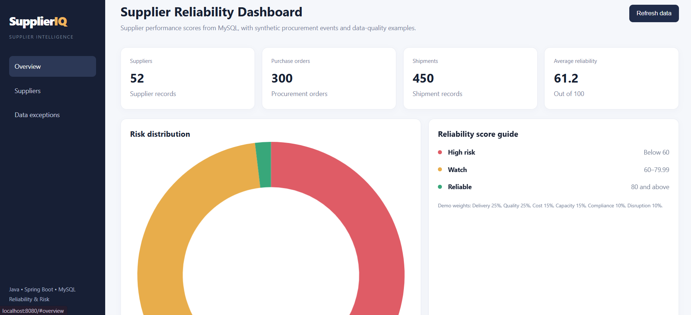

# SupplierIQ — Supplier Reliability & Procurement Intelligence Dashboard

SupplierIQ is a Java Spring Boot and MySQL project that analyzes supplier reliability, procurement operations, and data-quality issues using reproducible synthetic data. It provides a dashboard and REST APIs for exploring supplier scores, risk categories, operational records, and validation results.

**Project status:** Implemented demo  
**Tech stack:** Java 21 · Spring Boot · MySQL 8 · JDBC · Maven · HTML · CSS · JavaScript · Python

## Key Features

- **Supplier reliability dashboard:** View supplier performance scores and risk categories.
- **Risk classification:** Classify suppliers as `HIGH_RISK`, `WATCH`, or `RELIABLE`.
- **Relational procurement model:** Organize suppliers, sites, contracts, purchase orders, shipments, inspections, invoices, and risk signals into related tables.
- **Data-quality validation:** Identify invalid relationships and business-rule violations.
- **Synthetic data generation:** Generate reproducible CSV, JSON, and SQL datasets using a fixed seed.
- **Data-quality issue tracking:** Compare detected issues with documented ground-truth anomalies.
- **Historical records:** Maintain supplier score snapshots and state-transition history.
- **REST APIs:** Access supplier information, summary metrics, exceptions, and validation results.

## Technology Stack

| Component | Technology |
|---|---|
| Backend | Java 21, Spring Boot |
| Database | MySQL 8 |
| Database access | JDBC |
| Build tool | Maven |
| Frontend | HTML, CSS, JavaScript |
| Data generation and validation | Python 3.10+ |
| API style | REST |

## Dashboard Preview



## Architecture Overview

1. Synthetic procurement records are generated using a fixed random seed.
2. Spring Boot initializes the relational database schema and imports supported procurement records.
3. Supplier information and reliability scores are stored in MySQL.
4. REST APIs provide supplier data, summary metrics, exceptions, and validation results.
5. The web dashboard displays the available supplier and procurement information.

**Data-source note:** Supplier records and scores are read from MySQL. Some dashboard metrics and procurement details continue to use generated CSV files, as documented in the project. The synthetic dataset pipeline is reproducible and separate from the application's dashboard data flow.

## Supplier Reliability Scoring

The illustrative reliability score combines six components:

| Component | Weight |
|---|---:|
| Delivery | 25% |
| Quality | 25% |
| Cost | 15% |
| Capacity | 15% |
| Compliance | 10% |
| Disruption | 10% |

### Risk Categories

- **HIGH_RISK:** Score below 60
- **WATCH:** Score from 60 to below 80
- **RELIABLE:** Score of 80 or above

The model uses documented fallback values when observations are missing. These scores are intended for demonstration and learning, not as a validated production procurement policy.

## Implemented Business Rules

1. **Master-data-first imports:** Load suppliers and parent records before dependent records.
2. **Referential integrity:** Validate relationships between suppliers, sites, contracts, purchase orders, and related operational records.
3. **Business-rule validation:** Check applicable dates, quantities, ownership, shipment timelines, invoice variance, and required risk-signal fields.
4. **Historical tracking:** Store score snapshots and state transitions for traceability.
5. **Ground-truth validation:** Compare detected data-quality issues with explicitly documented synthetic anomaly labels.

Invalid operational records are recorded as data-quality issues rather than being treated as valid baseline records.

## REST API Endpoints

| Method | Endpoint | Purpose |
|---|---|---|
| GET | `/api/summary` | Dashboard summary metrics |
| GET | `/api/suppliers?q=&risk=ALL` | Search and filter suppliers |
| GET | `/api/suppliers/{supplierId}` | Retrieve supplier details |
| GET | `/api/exceptions` | View synthetic exception examples |
| GET | `/api/validation` | View validation summary |
| GET | `/api/data-quality/summary` | View relational entity and issue counts |
| GET | `/api/data-quality/issues` | Retrieve detected data-quality issues |
| GET | `/api/data-quality/validation` | Validate cross-entity relationships and date rules |

Use `?groundTruth=true` with `/api/data-quality/issues` to filter for intentional challenge cases.

## Requirements

- JDK 21
- Maven 3.9 or later
- MySQL Server 8.x
- Python 3.10+ for synthetic-data generation and verification

MySQL Workbench is optional.

## Getting Started

### 1. Clone the repository

```bash
git clone https://github.com/Jhansivelaga/SupplierIQ.git
cd SupplierIQ
```

### 2. Create the database

Run the following command in MySQL Workbench or the MySQL command line:

```sql
CREATE DATABASE IF NOT EXISTS supplieriq;
```

### 3. Configure database credentials

The application uses environment variables for database configuration. In PowerShell, set your credentials as follows:

```powershell
$env:DB_USERNAME = "root"
$env:DB_PASSWORD = "YOUR_MYSQL_PASSWORD"
```

Replace the placeholder with your local MySQL password. Do not commit real credentials to GitHub.

If your database uses a different host or port, configure `DB_URL` as described in `src/main/resources/application.properties`.

### 4. Run the application

From the project root, run:

```powershell
mvn spring-boot:run
```

Once the application starts successfully, open:

http://localhost:8080

Keep the terminal open while using the dashboard.

### 5. Verify database records

Run these queries in MySQL Workbench:

```sql
USE supplieriq;

SELECT COUNT(*) AS supplier_count
FROM supplier_performance;

SELECT supplier_id, name, reliability_score, risk_band
FROM supplier_performance
ORDER BY reliability_score DESC
LIMIT 10;

SELECT risk_band, COUNT(*) AS suppliers
FROM supplier_performance
GROUP BY risk_band;
```

The starter dataset is designed to contain 50 suppliers.

## Synthetic Data Generation and Testing

The repository includes reproducible synthetic datasets and verification scripts.

### Generate the full dataset

```powershell
python tools/generate_synthetic_data.py --out data/full --seed 20261022 --scale 1
```

### Run acceptance checks

```powershell
python tools/verify_acceptance.py data/full
```

### Verify reproducibility

```powershell
python tools/generate_synthetic_data.py --out data/full_repeat --seed 20261022 --scale 1
python tools/verify_reproducibility.py data/full data/full_repeat
```

The acceptance checks cover dataset counts, relationships, ownership, date and lifecycle rules, scoring, documented anomalies, and synthetic-data provenance.

For the complete field definitions, generation process, and verification details, see [`SYNTHETIC_DATA_GUIDE.md`](SYNTHETIC_DATA_GUIDE.md).

For entity relationships, keys, and lifecycle rules, see [`RELATIONAL_MODEL.md`](RELATIONAL_MODEL.md).

## Repository Structure

```text
SupplierIQ/
├── data/
│   ├── starter/
│   └── full/
├── sql/
│   └── demo_queries.sql
├── src/
│   └── main/
│       ├── java/com/supplieriq/
│       └── resources/
├── tools/
│   ├── generate_synthetic_data.py
│   ├── verify_acceptance.py
│   └── verify_reproducibility.py
├── pom.xml
├── README.md
├── RELATIONAL_MODEL.md
└── SYNTHETIC_DATA_GUIDE.md
```

## Data and Limitations

- All supplier names, identifiers, operational records, and amounts are synthetic.
- Reliability scores are illustrative and are not validated predictions of real supplier performance.
- Dashboard endpoints may combine MySQL-backed supplier data with generated CSV-based procurement information.
- Review the project documentation for the exact behavior of individual importers, endpoints, and validation checks.

## Future Enhancements

- Add automated unit and integration tests for database and API workflows.
- Add interactive charts and supplier performance trends.
- Improve filtering, reporting, and export capabilities.
- Extend validation and monitoring for additional procurement scenarios.

## Author

**Jhansi Divyanjani**

GitHub: [@Jhansivelaga](https://github.com/Jhansivelaga)

---

*SupplierIQ is an educational demonstration project built with synthetic data. It is not intended to replace real-world procurement validation or supplier risk assessment.*
